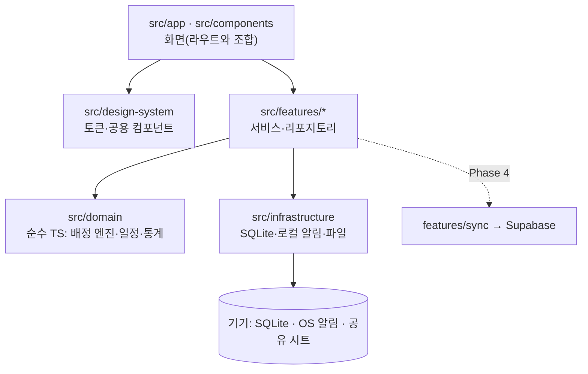

# 우리몫 (OurShare) 아키텍처

> 우리의 집안일, 우리의 몫
> 기준일 2026-11-05. 원본 기획은 [SUPER_PROMPT.md](SUPER_PROMPT.md), 원본과 달라진 점은 [DECISIONS.md](DECISIONS.md)에 있습니다.
> 단계 1(배정 엔진)까지 구현했습니다. 화면과 DB는 아직 없으며, 나머지 구조는 계획입니다.

## 1. 한눈에 보기

- iOS·Android 독립 앱. Expo SDK 58(React Native 0.88, React 19.3), TypeScript strict.
- **로컬 우선.** 로그인과 서버 없이 전 기능이 동작하고, 기기 안의 SQLite가 유일한 원본입니다.
- 앱이 외부로 보내는 데이터가 없습니다. 광고·분석·크래시 수집·OTA 업데이트 SDK를 넣지 않습니다.
- 여러 기기 공유는 Phase 4의 선택 기능입니다. 켜더라도 화면은 계속 SQLite만 읽고, 서버는 동기화 경로로만 씁니다.



### 의존 규칙

| 레이어 | 할 수 있는 것 | 금지 |
|---|---|---|
| `src/domain` | 자기 자신만 import | React, Expo, SQLite, `Date.now()`, `Math.random()` (현재 날짜와 seed는 인자로 받음) |
| `src/features` | domain, infrastructure | 화면 코드 import |
| `src/infrastructure` | Expo 모듈 호출 | 도메인 규칙 판단 |
| `src/app`, `src/components` | features, domain 타입, design-system | SQL 직접 실행, 임의 색·간격 |

`domain`의 금지 항목은 ESLint `no-restricted-imports`로 강제합니다.

**구조 원칙:** 판단은 순수 함수(`domain`)가 하고, 저장·알림 같은 부수 효과는 서비스(`features`)가 처리합니다. 서비스가 DB에서 읽은 값을 순수 함수에 넘기고 결과를 트랜잭션으로 저장하므로, 배정 엔진은 DB 없이 테스트할 수 있습니다.

## 2. 프로젝트 구조

기존 앱(딸깍, CutPick)과 같은 배치입니다. 라우트는 `src/app/`, 기능 코드는 `src/features/<기능>/`에 둡니다. **파일은 구현할 때 만들고 빈 파일을 미리 두지 않습니다.**

```text
OurShare/
├── AGENTS.md · CLAUDE.md          # 작업 규칙
├── README.md                      # 맨 끝에 Work Log
├── LICENSE
├── app.json · eas.json · metro.config.js · eslint.config.js · tsconfig.json · package.json
├── .env.example                   # 지원 이메일·운영자 이름만, 비밀값 없음
├── assets/
│   ├── brand/icon-source.webp     # 받은 아이콘 원본, 수정 금지
│   ├── images/                    # 스크립트로 생성한 아이콘·스플래시
│   ├── illustrations/             # 온보딩·완료 화면 일러스트
│   └── fonts/                     # Pretendard + OFL 전문
├── scripts/
│   ├── build-app-icons.py         # 아이콘 원본 → iOS/Android/스플래시
│   ├── generate-oss-licenses.mjs  # 출시 번들 기준 라이선스 감사·고지 생성
│   ├── build-legal-site.mjs       # 앱 내 정책 문구 → docs/legal/*.html
│   └── android-device.ps1         # adb 실기기 QA
├── src/
│   ├── app/                       # Expo Router (파일 = 화면)
│   │   ├── _layout.tsx            # DB 마이그레이션 완료 후 화면 표시
│   │   ├── index.tsx              # 온보딩/홈 분기
│   │   ├── onboarding/            # index(소개) · household · ratio · chores
│   │   ├── (tabs)/
│   │   │   ├── _layout.tsx        # 홈 · 일정 · 집안일 · 우리집
│   │   │   ├── index.tsx          # 홈
│   │   │   ├── schedule.tsx       # 주간 일정
│   │   │   ├── chores.tsx         # 집안일 목록
│   │   │   └── household.tsx      # 구성원·분배 방식
│   │   ├── chore/                 # new · [id] (집안일 설정)
│   │   ├── week/
│   │   │   ├── preview.tsx        # 배정 미리보기·다시 배정·확정
│   │   │   └── status.tsx         # 이번 주 현황
│   │   ├── completed.tsx          # 완료 축하(모달)
│   │   ├── notifications.tsx      # 알림함
│   │   ├── settings/              # index · reminders · backup
│   │   └── legal/[doc].tsx        # 처리방침 · 약관 · 오픈소스 고지
│   ├── components/                # 화면 조합 (ChoreRow, WeekStrip, ProgressRing, ShareBars 등)
│   ├── design-system/             # tokens · theme · components/
│   ├── domain/
│   │   ├── models.ts              # 타입, 상태·담당 방식 정의
│   │   ├── errors.ts
│   │   ├── allocation/
│   │   │   ├── allocation-policy.ts   # 가중치·상수는 이 파일 한 곳에만
│   │   │   ├── plan-week.ts           # 진입점
│   │   │   ├── balanced-assign.ts     # 후보 탐색과 비용 계산
│   │   │   ├── seeded-random.ts
│   │   │   ├── shares.ts              # 비율 검증·재분배·반올림
│   │   │   ├── load-history.ts        # 최근 4주 부담 보정
│   │   │   └── explain.ts             # 결과 설명 코드
│   │   ├── scheduling/
│   │   │   ├── date-only.ts           # YYYY-MM-DD 전용 계산
│   │   │   ├── week-range.ts
│   │   │   ├── expand-week.ts         # 템플릿 → 그 주 인스턴스
│   │   │   └── transitions.ts         # 완료·건너뜀·미루기·되돌리기, 재배정 가능 판정
│   │   └── stats/fairness.ts          # 목표/실제/완료 비율 계산
│   ├── features/
│   │   ├── household/             # 집·구성원·비율
│   │   ├── chores/                # 템플릿 CRUD, 기본 템플릿 데이터
│   │   ├── week-plan/             # 생성·미리보기·확정·재배정
│   │   ├── today/                 # 홈 요약, 완료·건너뛰기·미루기
│   │   ├── reminders/             # 알림 정책(순수) + 서비스
│   │   ├── activity/              # 알림함 기록
│   │   ├── backup/                # 버전 있는 JSON 내보내기/가져오기, 전체 삭제
│   │   ├── week-share/            # 이번 주 일정 텍스트 공유
│   │   ├── legal/                 # 정책 문구, oss-licenses.json
│   │   └── preferences/           # kv 설정
│   ├── infrastructure/
│   │   ├── database/              # database.ts · migrations.ts
│   │   └── notifications/         # local-notifications.ts (+ .web.ts)
│   ├── hooks/
│   └── utils/
├── tests/
│   ├── unit/{allocation,scheduling,stats,reminders,backup}/
│   ├── simulation/                # 다양한 입력 반복 + 순수 랜덤과 편차 비교
│   └── integration/               # 온보딩 → 생성 → 확정 → 완료 흐름
└── docs/
    ├── ARCHITECTURE.md · DECISIONS.md · DATA_MODEL.md · ALLOCATION_ALGORITHM.md
    ├── DESIGN_SYSTEM.md · PRIVACY.md · LICENSES.md · COSTS_AND_DISTRIBUTION.md
    ├── SUPER_PROMPT.md
    ├── design/reference-screens.webp
    └── legal/                     # GitHub Pages로 공개되는 정책 페이지 (생성물)
```

`supabase/`와 `features/sync/`는 Phase 4를 시작할 때만 만듭니다.

## 3. 핵심 흐름

### 주간 일정 생성

1. `week-plan-service`가 템플릿·구성원·최근 4주 이력을 읽습니다.
2. 순수 함수 `expandWeek` → `planWeek`로 **미리보기를 메모리에서만** 만듭니다. DB는 그대로입니다.
3. 사용자가 담당자 변경·잠금·다시 배정을 반복합니다. 다시 배정은 새 seed로 `planWeek`를 재실행합니다.
4. 확정하면 한 트랜잭션에 `week_plan`, 비율 스냅샷, `scheduled_chore`, 활동 기록을 저장합니다.
5. 커밋 후 알림을 다시 맞춥니다. 알림이 실패해도 일정은 남습니다.

같은 주의 중복 확정은 `UNIQUE(household_id, week_start_date)`로 막습니다.

### 알림

- OS 스케줄러는 `reminder-service`만 호출합니다.
- DB를 기준으로 **앞으로 14일, 최대 50건**을 계산해 전부 취소 후 다시 예약합니다. iOS의 대기 알림 수 제한(64건)을 넘지 않기 위한 값입니다.
- 앱 시작, 복귀, 일정 변경 때 실행합니다. 예약을 DB에 따로 기록하지 않으므로 어긋날 수 없습니다.
- 정시 전달은 약속하지 않습니다. 정확한 알람 권한은 쓰지 않습니다.
- 첫 일정 확정 후에 권한을 요청합니다. 거부해도 다른 기능은 그대로 동작합니다.

### 앱 시작

`마이그레이션 → 설정 로드 → 스플래시 해제 → 온보딩/홈 분기 → 알림 재동기화`
마이그레이션이 실패하면 데이터를 지우지 않고 오류 화면과 백업 안내를 보여 줍니다.

### 공유 (Phase 4 전까지)

서버 없이 "이번 주 일정 보내기"로 OS 공유 시트에 텍스트를 넘깁니다. 한 기기만 쓰는 집도 상대방에게 일정을 전달할 수 있습니다. 실시간 동기화처럼 보이게 만들지 않습니다.

### 나중에 켤 공유 모드 (Phase 4)

- 처음부터 모든 공유 대상 테이블에 UUID, `updated_at`, `version`, `deleted_at`을 둡니다. 동기화를 추가해도 테이블을 뜯어고치지 않기 위해서입니다.
- 쓰기는 먼저 SQLite에 하고 변경 기록을 큐에 쌓아 서버로 보냅니다. 서버가 멈춰도 앱은 계속 동작합니다.
- 충돌은 `version`으로 감지해 사용자에게 보여 주며, 무조건 덮어쓰지 않습니다.
- 초대 토큰은 128비트 이상을 해시로 저장하고, 전 테이블에 RLS를 적용합니다. 계정 삭제는 앱 안과 웹 양쪽에 제공합니다.

## 4. 기술 스택과 기존 앱 재사용

| 영역 | 선택 | 기존 앱에서 가져올 것 |
|---|---|---|
| 앱 설정 | CNG(`android/`, `ios/`는 생성물, git 제외), React Compiler | `app.json`, `eas.json`, `blockedPermissions` 구성 (딸깍) |
| 라우팅 | Expo Router, `src/app` | 동일 |
| DB | `expo-sqlite`, WAL, `PRAGMA user_version` 순차 마이그레이션 | `database.ts` 패턴 (딸깍) |
| 알림 | `expo-notifications` (DATE 트리거) | `local-notifications` + `.web.ts` 경계 (딸깍) |
| 백업 | `expo-file-system`, `expo-sharing`, `expo-document-picker` | 버전 있는 포맷, 가져오기 계획 분리 (딸깍) |
| 그래프 | `react-native-svg` 15.16 (MIT) | 신규. 진행률 링에 필요 |
| 글꼴 | Pretendard (OFL-1.1) | 폰트와 OFL 전문 |
| 아이콘 | `@expo/vector-icons` | 동일 |
| ID | `expo-crypto` `randomUUID` | 신규 |
| 테스트 | Jest + `jest-expo` | 설정 동일 |
| 라이선스 | 번들 소스맵 기반 감사 | `generate-oss-licenses.mjs` (CutPick) |
| 정책 페이지 | 앱 내 문구 → 정적 HTML, GitHub Pages | `build-legal-site.mjs` (CutPick) |
| 실기기 QA | adb 스크립트, 캡처는 `.device/`(git 제외) | `android-device.ps1` |
| 빌드 | 개발은 로컬 Gradle, 배포는 EAS (`owner: lcm2`) | 기존 `C:\eclipse_AI\.gradle-home`, `.android-sdk` |

재사용하는 것은 구성과 연동 방식뿐이고, 기능 코드는 가져오지 않습니다.

식별자: `name` 우리몫, `slug` ourshare, `scheme` ourshare, 번들 ID·패키지 `app.ourshare.mobile`.

넣지 않는 것: Reanimated, 상태 관리 라이브러리, 날짜 라이브러리, 차트 라이브러리, Sentry·Analytics, `expo-updates`, Supabase(Phase 4 전까지).

## 5. 검증 환경

개발 PC가 Windows이고 Mac이 없어 iOS 시뮬레이터를 쓸 수 없습니다. 그래서 원문의 "iOS 우선" 대신 **Android 실기기로 먼저 검증하고, iOS는 EAS 빌드와 TestFlight 실기기로 확인**합니다.

상태는 항상 `구현 / 자동 테스트 / Android 실기기 / iOS TestFlight / 스토어 제출`로 나누어 기록합니다.

## 6. 단계

| 단계 | 내용 | 완료 기준 |
|---|---|---|
| 1. 배정 엔진 | 프로젝트 생성, `domain` 전체, 테스트·시뮬레이션 | 60:40, 50:30:20, 고정 혼합이 테스트 통과 |
| 2. 뼈대 | 디자인 시스템, 아이콘, DB, 온보딩, 구성원, 집안일 | 오프라인에서 저장·수정·삭제, 재시작 후 유지 |
| 3. 주간 운영 | 미리보기·확정, 일정, 완료·되돌리기, 현황, 알림함 | Android 실기기에서 한 주 전체 시나리오 통과 |
| 4. 출시 기능 | 로컬 알림, 백업·복원, 전체 삭제, 정책·고지 화면, 접근성 | 권한 거부·재부팅·복원 실기기 확인 |
| 5. 출시 | EAS 빌드, TestFlight, Play 비공개 테스트, 스토어 등록 | [체크리스트](COSTS_AND_DISTRIBUTION.md) 완료 |
| 이후 | 공유 모드 (Supabase) | 필요성 확인 후 별도 착수 |

원문의 Phase 4(공유)는 출시 뒤로 옮겼습니다. 이유는 [D-009](DECISIONS.md)에 있습니다.
