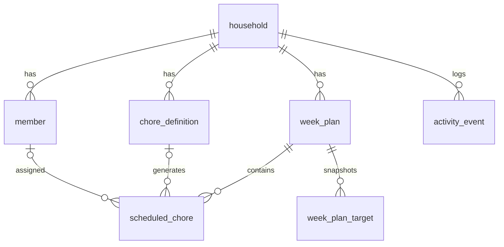

# 데이터 모델

SQLite 하나가 원본입니다. 날짜는 `YYYY-MM-DD` 문자열, 시각은 ISO 8601 UTC, 요일은 0(일)~6(토)입니다. 모든 ID는 UUID입니다.

`동기화 대비`로 표시한 테이블에는 `created_at`, `updated_at`, `version`, `deleted_at`이 포함됩니다.

## household (동기화 대비)

| 컬럼 | 타입 | 설명 |
|---|---|---|
| id | TEXT PK | |
| name | TEXT | 예: 우리집 |
| week_starts_on | INTEGER | 0 또는 1. 기본 1 |
| metric | TEXT | `POINTS`, `TASK_COUNT` |
| share_preset | TEXT | `EQUAL`(공평하게), `CUSTOM`(내가 비율 지정) |
| mode | TEXT | `LOCAL`만 사용. `SHARED`는 이후 |

시간대는 저장하지 않습니다. 기기의 현재 지역 날짜를 기준으로 계산합니다.

## member (동기화 대비)

| 컬럼 | 타입 | 설명 |
|---|---|---|
| id | TEXT PK | |
| household_id | TEXT FK | |
| display_name | TEXT | 별칭 가능 |
| color_key | TEXT | 토큰 이름 |
| avatar_key | TEXT | 내장 아바타 이름. 사진은 받지 않음 |
| target_share_percent | INTEGER | 0~100. 활성 구성원 합계 100 |
| is_active | INTEGER | 비활성은 신규 배정 제외, 이력 유지 |
| sort_order | INTEGER | |

## chore_definition (동기화 대비)

| 컬럼 | 타입 | 설명 |
|---|---|---|
| id | TEXT PK | |
| household_id | TEXT FK | |
| title | TEXT | |
| category | TEXT | 청소/세탁/쓰레기/주방/정리/반려동물/기타 (아이콘 결정) |
| weekdays_mask | INTEGER | 요일 비트마스크, 1이상 |
| due_time | TEXT NULL | `HH:mm` |
| assignment_mode | TEXT | `FIXED`, `AUTO_BALANCED_RANDOM`, `MANUAL` |
| fixed_member_id | TEXT NULL FK | `FIXED`일 때 필수 |
| workload_points | INTEGER | 1~5. 기본 3 |
| estimated_minutes | INTEGER NULL | |
| reminder_mode | TEXT | `NONE`, `SAME_DAY`, `DAY_BEFORE` |
| notes | TEXT NULL | |
| is_active | INTEGER | |
| sort_order | INTEGER | |

## week_plan (동기화 대비)

주간 일정 1건입니다. 확정 시점에만 생성되며, 미리보기는 저장하지 않습니다.

| 컬럼 | 타입 | 설명 |
|---|---|---|
| id | TEXT PK | |
| household_id | TEXT FK | |
| week_start_date | TEXT | `UNIQUE(household_id, week_start_date)` |
| metric | TEXT | 확정 당시 값 |
| seed | TEXT | 결과 재현용 |
| algorithm_version | INTEGER | 정책 변경 시 증가 |
| confirmed_at | TEXT | |

## week_plan_target

그 주에 적용된 목표 비율입니다. `PK(week_plan_id, member_id)`. 비율을 바꿔도 지난 주 통계가 변하지 않습니다.

| 컬럼 | 타입 |
|---|---|
| week_plan_id | TEXT FK |
| member_id | TEXT FK |
| target_share_percent | INTEGER |

## scheduled_chore (동기화 대비)

| 컬럼 | 타입 | 설명 |
|---|---|---|
| id | TEXT PK | |
| household_id, week_plan_id | TEXT FK | |
| chore_definition_id | TEXT NULL FK | 템플릿을 지워도 이력 유지 |
| local_date | TEXT | 실제 표시 날짜. 인덱스 |
| original_local_date | TEXT | 생성 시 날짜. 미루기 후에도 유지 |
| title_snapshot, category_snapshot | TEXT | 템플릿 수정과 무관 |
| workload_points_snapshot | INTEGER | |
| estimated_minutes_snapshot | INTEGER NULL | |
| due_time_snapshot | TEXT NULL | |
| reminder_mode_snapshot | TEXT | |
| assignee_member_id | TEXT NULL FK | NULL은 담당자 미정 |
| assignment_origin | TEXT | `FIXED`, `AUTO`, `MANUAL` |
| is_locked | INTEGER | 사용자 잠금 |
| status | TEXT | `TODO`, `DONE`, `SKIPPED`, `CANCELLED` |
| completed_by_member_id | TEXT NULL FK | 담당자와 다를 수 있음 |
| completed_at | TEXT NULL | |
| skipped_reason, notes | TEXT NULL | |

제약: `UNIQUE(week_plan_id, chore_definition_id, original_local_date)`.

## activity_event

알림함에 보여 주는 기기 내 기록입니다. 90일이 지나면 정리합니다.

| 컬럼 | 타입 | 설명 |
|---|---|---|
| id | TEXT PK | |
| household_id | TEXT FK | |
| type | TEXT | `WEEK_ASSIGNED`, `CHORE_DUE`, `CHORE_DONE` |
| ref_id | TEXT NULL | 관련 일정 |
| occurred_at | TEXT | |
| read_at | TEXT NULL | 홈의 종 아이콘 표시 |

제목에 이름을 저장하지 않고, 표시할 때 일정에서 조합합니다.

## kv

설정값입니다. 기기별 값이라 동기화하지 않습니다. 예: `me_member_id`, `celebration_enabled`, `onboarding_done`, `reminder_time`.

## 규칙

- 담당자 변경 시 `assignment_origin = MANUAL`, `is_locked = 1`.
- 재배정 대상은 `canReassign()` 하나로 판정합니다. `origin = AUTO`, `TODO`, 잠금 아님, 오늘 이후여야 합니다.
- 완료 취소 시 `completed_by_member_id`, `completed_at`을 비웁니다.
- 구성원을 비활성화해도 지난 일정의 담당자는 유지합니다. `FIXED` 담당자라면 먼저 경고합니다.
- 템플릿 수정은 확정된 주에 영향이 없습니다.
- 마이그레이션은 단방향이고 단계마다 트랜잭션을 씁니다.
- DB 파일은 암호화하지 않으며 OS 앱 샌드박스에 의존합니다. 민감도와 복잡도를 고려한 결정입니다. 백업 파일은 사용자가 직접 공유하기 전에 민감할 수 있다고 안내합니다.
